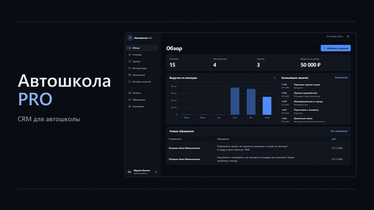
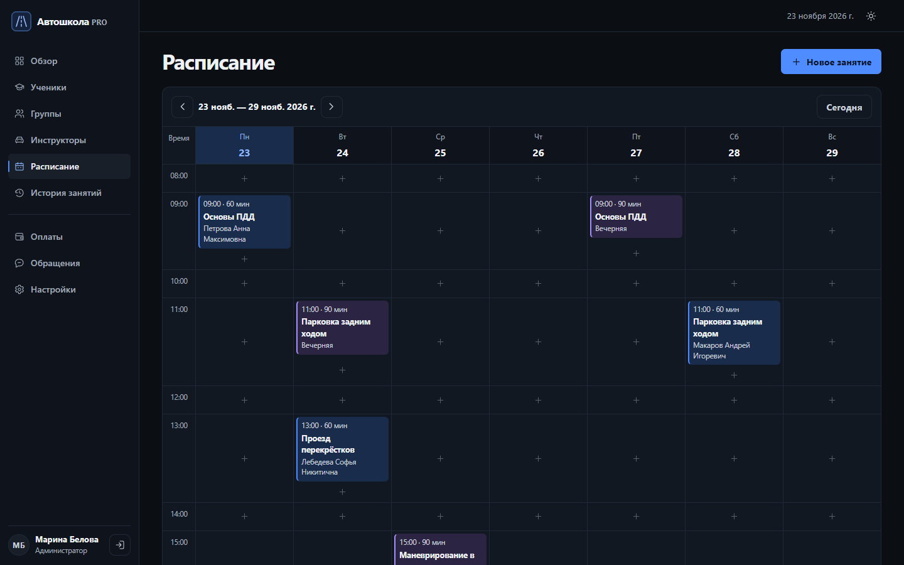
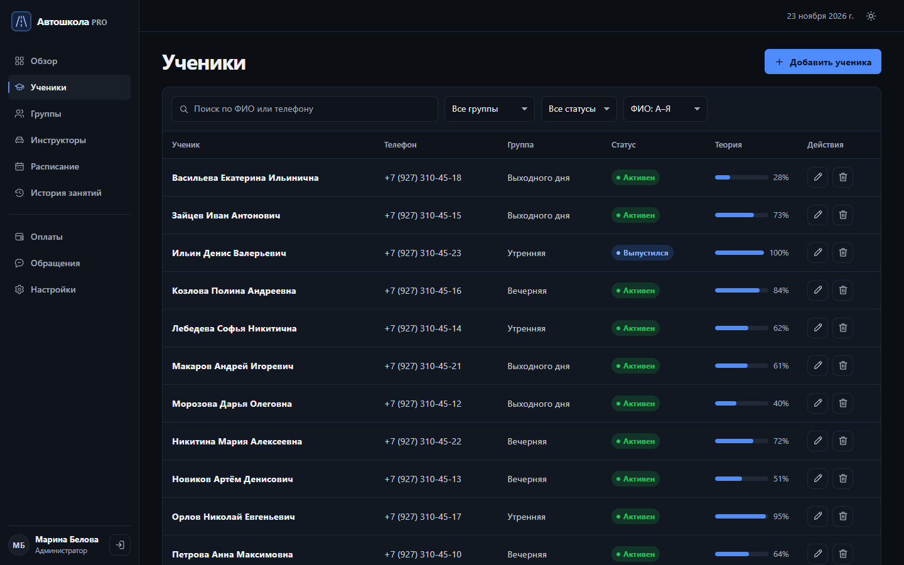
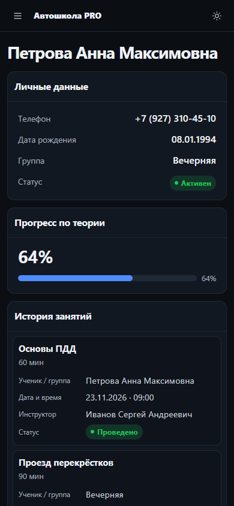

# Автошкола PRO

**CRM для автошколы с расписанием, карточками учеников и учётом оплат.**

[Смотреть видео на GitHub Pages](https://rostislav-565.github.io/autoshkola-pro-showcase/) · [Открыть MP4](https://raw.githubusercontent.com/Rostislav-565/autoshkola-pro-showcase/main/videos/autoshkola-pro-promo.mp4)

## О проекте

«Автошкола PRO» объединяет ежедневные задачи администратора автошколы. Он ведёт группы и инструкторов, назначает занятия, регистрирует оплаты и обрабатывает обращения. Инструктор видит своих учеников и занятия, а ученик — личное расписание, прогресс и чеки.

В витрине показан рабочий интерфейс с демонстрационными данными. Ролик длится 30 секунд, снят в 1920 × 1080 и рассчитан на просмотр без звука.

## Что показано в ролике

| Сценарий | Что видно в интерфейсе |
| --- | --- |
| **Ученики** | Поиск по ФИО и телефону, группа, статус и прогресс по теории. |
| **Расписание** | Недельная сетка, карточка занятия и перенос завершённых занятий в историю. |
| **Оплаты** | Журнал платежей, сумма и печатный чек с уникальным номером. |
| **Кабинеты** | Ограничения доступа для инструктора и мобильная карточка ученика. |

## Скриншоты

## Технологии

TypeScript strict, Node.js 24, SQLite, HTML и CSS. Пересечения занятий проверяются в базе, права доступа — на сервере. Интерфейс адаптирован для телефона и поддерживает две темы.
